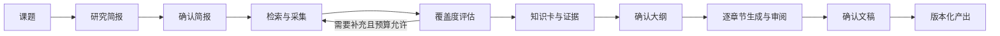

# 光谱 OS · SpectrumOS 0.5.0

围绕科研课题运行资料采集、知识提炼与文稿生成。研究简报、大纲和文稿分别经过确认，研究结果可追溯至版本化原文片段。

## 研究流程



LangGraph 管理节点、分支和人工暂停。PostgreSQL 保存业务数据及工作流检查点。Celery/Redis 分发运行，事务 outbox 与 PostgreSQL 会话锁防止重复执行。

## 功能

- 课题、研究运行、节点、审核分别保存状态；支持取消运行、失败后恢复检查点。
- 简报、大纲和文稿可编辑、预览并查看修改差异；人工修改保存为独立版本。
- 素材版本、原文片段、知识主张和文稿引用通过数据库关系关联。
- 中文 jieba 分词、PostgreSQL 全文检索和 pgvector 向量检索结合排名，限定研究领域。
- 使用本地 `BAAI/bge-small-zh-v1.5` 嵌入模型，维度为 512。
- 通过 Tavily 检索资料；缺少正文时使用 Jina Reader 提取。模型结果使用 Pydantic 严格校验。
- 调用前预留模型费用，保存实际 Token、耗时和估算费用；支持次数、搜索数量、材料数量、轮次和执行时间预算。
- 原文和文稿按内容哈希保存到 S3 兼容对象存储。
- Next.js 工作台通过 SSE 接收运行进度，提供材料输入、知识浏览、审核、日志与 Markdown 导出。
- 支持 OpenTelemetry 导出及可选 Langfuse 观测。

## 本机启动

需要 Python 3.11+、Node.js 22+、Docker Compose，以及模型和搜索服务的实际凭据。

```bash
cp .env.example .env
uv sync --extra dev --frozen
docker compose up -d postgres redis storage
uv run spectrum migrate
```

在 `.env` 中配置 `CLAUDE_API_KEY`、`CLAUDE_BASE_URL`、`TAVILY_API_KEY`。模型可以通过 `SPECTRUM_MODEL` 修改；密钥和服务地址对应的环境变量名称也可配置。

分别启动以下进程：

```bash
uv run spectrum run
uv run spectrum worker
uv run spectrum beat
npm ci --prefix frontend
npm run build --prefix frontend
npm run start --prefix frontend
```

工作台地址为 `http://127.0.0.1:3000`，API 地址为 `http://127.0.0.1:8078`。本机服务端口分别为 PostgreSQL 55432、Redis 56379、对象存储 59000。

首次检索会下载嵌入模型到 `.work/models`。

## 容器部署

在 `.env` 设置 `SPECTRUM_API_TOKEN`，然后执行：

```bash
docker compose --profile app up -d --build
```

部署包含数据库、消息服务、对象存储、迁移、API、工作进程、调度进程和工作台。API 在容器网络监听时要求访问凭据；工作台代理在服务端注入凭据。所有对宿主机开放的端口默认绑定本机地址。对外提供工作台时，应在反向代理配置用户认证和 HTTPS。

## 配置

v0.5.0 运行配置由 `SPECTRUM_` 前缀环境变量提供，定义见 `src/spectrum/runtime_config.py`。旧 `config/settings.yaml` 用于旧模块，新的入口不读取其中的调度和数据库配置。

| 配置 | 作用 |
|---|---|
| `SPECTRUM_DATABASE_URL` | PostgreSQL SQLAlchemy 地址 |
| `SPECTRUM_REDIS_URL` | Celery 消息服务 |
| `SPECTRUM_API_TOKEN` | API 访问凭据；前后端进程必须一致 |
| `SPECTRUM_MODEL` | 模型名称 |
| `SPECTRUM_MODEL_KEY_ENV` | 模型密钥所在环境变量 |
| `SPECTRUM_MODEL_BASE_URL_ENV` | 兼容接口地址所在环境变量 |
| `SPECTRUM_INPUT_PRICE_PER_MILLION` | 输入 Token 每百万单价（美元） |
| `SPECTRUM_OUTPUT_PRICE_PER_MILLION` | 输出 Token 每百万单价（美元） |
| `SPECTRUM_S3_ENDPOINT` | S3 兼容服务地址 |
| `SPECTRUM_OTLP_ENDPOINT` | OTLP HTTP traces 接收地址 |
| `SPECTRUM_LANGFUSE_ENABLED` | 启用 Langfuse；同时配置其官方环境变量 |

模型费用按照配置单价计算；搜索、存储等服务费用由对应服务单独计费。请求结果未知时保留预算预留，恢复操作不会静默重复该模型或搜索请求。

## 数据迁移

```bash
uv run spectrum import-sqlite /absolute/path/to/spectrum.db
```

先完成 `spectrum migrate`，再向空的 PostgreSQL 业务表导入。迁移只读原 SQLite，保留主键，验证外键与记录数量，在事务中完成。关系失效或目标已有业务数据时立即终止。原始文件保留。历史原文需要重新采集后才能生成原文片段和向量索引；历史未完成任务保留为记录，后续研究使用新运行启动。

## 验证

```bash
uv run pytest checks/ -v
npm run typecheck --prefix frontend
npm run build --prefix frontend
```

`checks/` 连接实际 PostgreSQL、S3 和 API，以仓库中的真实 RFC 文档核对保存与检索。检查会新建带有“项目文档核验”名称的课题，并保留审计记录。`tests/` 中保留旧模块的测试，独立于新运行机制。

完整研究验证需要实际模型与搜索凭据；发布验证状态见 `docs/v0.5.0-validation.md`。

## 主要实现

- `orchestrator/workflow.py`：LangGraph 研究节点与确认流程。
- `orchestrator/worker.py`：消息分发、运行锁、心跳、失败状态。
- `orchestrator/service.py`：启动、审核、取消与恢复。
- `db/research.py`：运行、原文、证据、版本与调用记录。
- `api/research.py`：业务接口、鉴权与 SSE。
- `tools/knowledge.py`：正文保存与中文混合检索。
- `frontend/`：Next.js 研究工作台。
- `migrations/`：Alembic 数据库迁移。

所有变更通过分支与 PR 合入。架构说明见 RFC 001。
